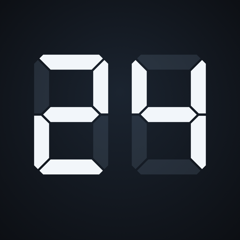
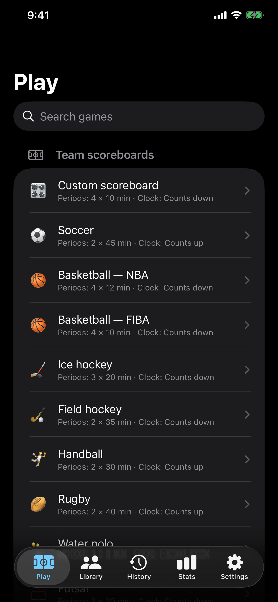
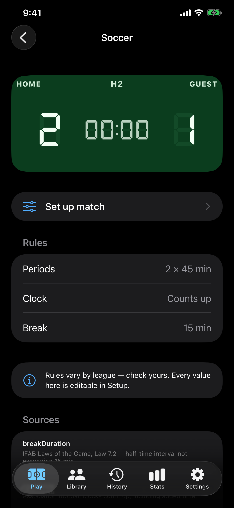
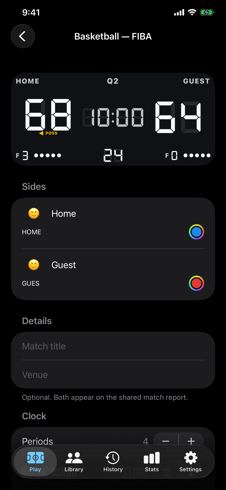
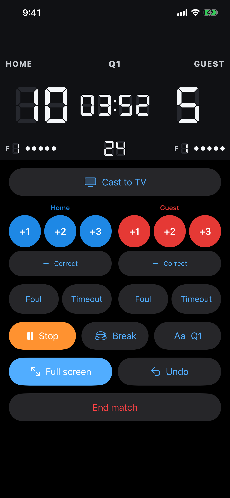
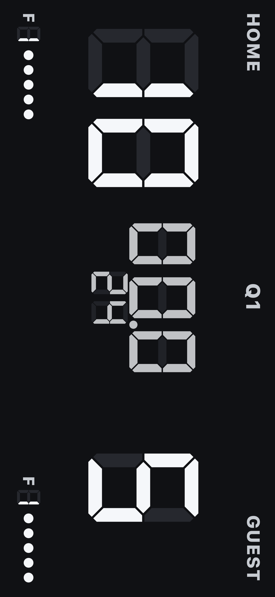

# ScoreDock

**ScoreDock** is a native iOS/iPadOS scoreboard for the person actually running the game —
not a spectator's score-tracking app, but the operator's console. Pick from 37 built-in
sports or build your own, score with one tap, and put the board on a TV or projector over
AirPlay while the controls stay in your hand. The clock is anchored to real time rather
than counted down by the app, so locking the phone, taking a call, or force-quitting never
costs you the match.

 

Built entirely with Swift, SwiftUI and SwiftData — no third-party dependencies, no
analytics, no account, no network code of any kind. Every feature is free.

## Features

- **37 sports, 4 engine families, out of the box.** 20 team scoreboards (basketball,
  soccer, handball, water polo, ice/field hockey, rugby, and more), 8 set-based sports
  (tennis, volleyball, badminton, squash, table tennis, darts), 4 list/table formats
  (leaderboard, league standings, knockout bracket, score sheet), and 5 bespoke boards
  built one sport at a time: chess clock, race timer, American football, cricket, baseball.
- **Every rule is editable**, and a match keeps the exact rules it was played under, even
  if the built-in preset changes later.
- **A board people can actually read.** Twelve themes, each checked to a 7:1 contrast
  minimum between digits and background. A real seven-segment display face, with the
  unlit segments showing behind the score the way a physical venue board does.
- **The clock is right, always.** Date-anchored, not tick-counted — so it survives the
  app being backgrounded, the phone being locked, or a call coming in. A match left
  running is offered for resume next time you open the app, on whichever engine it was
  played on.
- **Full event log with unlimited undo.** Every action is stamped with both the time of
  day and the game clock, so a disputed call lines up against video afterward. Undo is
  itself part of the record — the log shows what happened, including corrections.
- **Cast to a TV.** The external display always shows the real board for whichever sport
  is running — the same view, not a re-drawing of it — while the phone keeps the operator
  controls.
- **Share it five ways:** a scorecard image, plain text, a formatted PDF, a CSV of every
  event, or the whole match as a file that a friend with the app opens as a full report.
- **Players and teams with real stats.** Save a team once with its colours and crest,
  credit points to individual players (off by default, so scoring stays one tap), and
  watch records build up across every match.
- **Hebrew and English**, with full right-to-left support — board numerals never mirror,
  chrome and navigation do.
- **Private by construction.** Nothing leaves the device except a file you explicitly
  share. No analytics, no telemetry, no account, and the privacy manifest says so — and
  is tested to keep saying so.

## Screenshots

| Sport picker | Preset detail | Match setup |
|---|---|---|
|  |  |  |

| Live control panel | Full board |
|---|---|
|  |  |

The full-board screenshot shows the board exactly as it renders when the interface
rotates to landscape — captured without physically rotating the simulator, so the
content appears turned 90° within the portrait frame; turn your head (or the image) to
read it the way it looks on device.

App Store–ready assets (1242×2688, named `ScoreDock-<view>-<resolution>.png`) live in
[`Marketing/`](Marketing).

## Tech stack

- **Swift 6** and **SwiftUI** only — no UIKit view controllers, no third-party
  dependencies
- **iOS 26.0** minimum deployment target
- **SwiftData**, with a schema kept CloudKit-safe from the first commit: every property
  optional or defaulted, no `.unique` attributes, raw-string enums, explicit inverse
  relationships
- Xcode 16+ **synchronized folder groups** — files added under `ScoreDock/` or
  `ScoreDockTests/` are picked up automatically, no `project.pbxproj` edits
- Four pure, independently testable `ScoreEngine` implementations (team / set-match /
  list / specialised), each driven by an event-sourced log with recursive undo
  resolution and periodic snapshotting
- `UIWindowSceneSessionRoleExternalDisplayNonInteractive` for the external-display scene,
  `AVAudioSession` for the silent-switch-proof buzzer, Core Haptics for feedback
- `ImageRenderer`, `UIGraphicsPDFRenderer` and `PDFKit` for the five share formats;
  EXIF/GPS stripped from every shared image by re-encoding onto a fresh bitmap
- **Swift Testing** — 333 tests across 25 suites, covering WCAG contrast math, CloudKit
  schema validation (with a negative control), event-sourcing correctness, every sport's
  scoring rules, and the privacy manifest's own claims

## Documentation

- [`docs/DEVELOPMENT.md`](docs/DEVELOPMENT.md) — the full build log: milestone-by-milestone
  exit criteria, every bug found and fixed with its root cause, and the reasoning behind
  the harder design decisions (why the clock is date-anchored, why undo is event-sourced
  rather than state-restored, why the four engines are siblings rather than one generic
  store).
- [`Submission/listing.md`](Submission/listing.md) — the drafted App Store listing copy
  and privacy-questionnaire answers.
